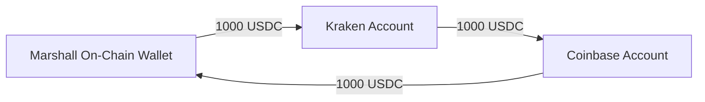

# Forensic Audit Report: Marshall Effect Reconciliation

This document presents the forensic reconciliation analysis performed by the **Marshall Effect Scan Engine** on the cleared liquidity record ledger.

---

## Audit Metadata
*   **Scan Timestamp**: 2026-07-02T06:26:42.819Z
*   **Total Transactions Scanned**: 14
*   **Status**: **WARNING** (Anomalies & Discrepancies Detected)

---

## 1. Discrepancies (Data Integrity Issues)

We verify all yields against verified protocol and validator whitelists. The following items violated this integrity rule:

| Transaction ID | Event / Action | Amount / Asset | Source | Detail / Violation |
| :--- | :--- | :--- | :--- | :--- |
| `tx_anomaly_yield_spike` | `yield.reward` | 500.0 ETH | ScamPool Staking Protocol | **UNAUTHORIZED_YIELD_SOURCE**: Staking provider is not in the whitelist of trusted operators (Kiln, Figment, Lido). |

---

## 2. Anomalies (State and Value Invariance Violations)

We flag transactions exceeding our value thresholds or violating state flow patterns.

### Value Spikes
*   **Entry `tx_anomaly_weekend`**: Large outbound withdrawal of **$75,000 USD** to `External Bank Acct 9912`. (Alert threshold: > $50,000 USD).
*   **Entry `tx_anomaly_yield_spike`**: Single-transaction staking yield reward of **500.0 ETH** (~$1,500,000 equivalent) attributed to `ScamPool Staking Protocol`. (Alert threshold: > 1.0 ETH).

### Circular Transaction Loop
A cyclic transaction loop of funds moving through exchanges and returning to the source wallet without commercial justification:

*   **Affected Entries**: `tx_loop_001`, `tx_loop_002`, `tx_loop_003`.
*   **Assessment**: High-risk pattern typical of wash-trading, yield-loop manipulation, or liquidity recycling.

### Timing Irregularities
*   **Entry `tx_anomaly_weekend`**: Withdrawal executed at **2026-06-28T02:15:00.000Z** (Sunday, 2:15 AM). Outside standard weekday operational hours.

---

## 3. Velocity Analysis (High-Frequency Activity)

We monitor the rate of transaction execution to block automated sweeps or wallet-draining vectors.

*   **Alert**: `HIGH_VELOCITY_BURST`
*   **Pattern**: 5 transactions of $10 CAD each executed between `16:45:00Z` and `16:45:20Z` (20-second interval).
*   **Impact**: Indicates potential programmatic execution or automated policy bypass.

---

## Summary of Action Required

1.  **Freeze Source**: Flag and block wallet operations originating from `tx_anomaly_yield_spike`'s associated private key.
2.  **Verify Sweep**: Investigate the $75,000 weekend withdrawal from Coinbase Prime.
3.  **Harden Rate-Limiter**: Review rate-limiting thresholds on the withdrawal API gateway to throttle bursty operations.
